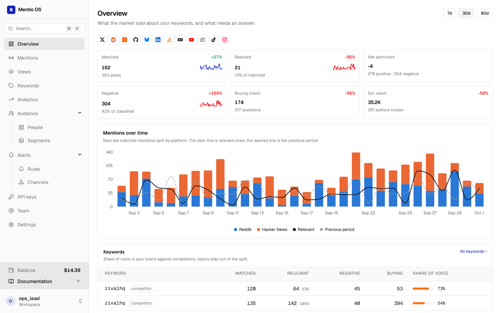

# Mentio OS



A complete, open-source social listening dashboard built on the [Mentio API](https://docs.mentio.dev). Fork it, put your name on it, and ship your own product. Mentio does the listening across Reddit, X, Hacker News, GitHub, YouTube, TikTok, Instagram, LinkedIn, Bluesky, app stores and more, scoring every mention for relevance, sentiment and intent. This app gives your users the screens to work with it.

```bash
git clone https://github.com/mentio-dev/mentio-os.git my-dashboard
cd my-dashboard
npm install
npm run demo        # try it on invented data, no key needed: http://localhost:3000
```

## Built like the best open-source dashboards

shadcn/ui throughout, and the patterns of Dub, Midday and OpenStatus: a ⌘K command menu and single-key shortcuts (`/` search, `C` create), filter chips kept in the URL, records and create forms in drawers (a click anywhere on a row opens one; unsaved changes ask before closing), bulk triage with a floating action bar, toasts, loading skeletons, light and dark themes, and an optional password in front of everything.

## What is inside

Every screen is a thin page over the public API, one folder per page in `src/app`.

| Area | Pages | API |
| --- | --- | --- |
| Overview | Last 30 days, trend, top platforms and intents, wallet, what needs an answer | analytics, usage, mentions |
| Mentions | The feed with every filter, saved views as a base, CSV export; a detail page with triage (status, assignee, snooze, note), verdict feedback and muting the author | `/v1/mentions`, `/v1/views` |
| Analytics | Summary with the previous window, series, breakdowns, share of voice, the reviews report | `/v1/analytics/*` |
| People | The audience with filters and CSV export; a profile with tags, notes, owner, activity log, merge and split; segments | `/v1/people`, `/v1/segments` |
| Keywords | List, create and edit with platforms, rules, context, monthly cap, group and connected review apps | `/v1/keywords` |
| Alerts | Rules (instant or digest) with the full filter, test, run a digest, muted authors; channels (Slack, email, webhook, Telegram) with test, secret rotation and delivery log | `/v1/alerts`, `/v1/channels` |
| Settings | Company profile, groups, noise filters, team and invitations, API keys, billing (wallet, top-up, ledger, invoices, cost per keyword) | `/v1/company`, `/v1/groups`, `/v1/filters`, `/v1/members`, `/v1/api-keys`, `/v1/billing/*`, `/v1/usage` |

Next.js (App Router), React, Tailwind and shadcn/ui, with the official [`@mentio-dev/sdk`](https://www.npmjs.com/package/@mentio-dev/sdk). No database: Mentio is the backend.

## Use your own workspace

```bash
cp .env.example .env.local   # paste your key
npm run dev                  # http://localhost:3000
```

The key comes from the Mentio dashboard (Settings, API keys) or `POST /v1/api-keys`. Every account starts with free credit and no card. A read key gives a read-only dashboard: every write answers with the API's own 403, shown next to the button.

## Make it yours

- **Brand**: [`src/brand.config.ts`](src/brand.config.ts) holds the name, the logo (a file in `public/`), the accent color and the tab description. The accent flows into every button, link, badge and chart.
- **Look**: the UI is [shadcn/ui](https://ui.shadcn.com) (style `base-nova` on Base UI, the same components the Mentio dashboard uses) in [`src/components/ui`](src/components/ui); add more with `npx shadcn add <name>`. The theme is the tokens in [`src/app/globals.css`](src/app/globals.css). Pages compose them through a small kit (`src/components/ui/index.tsx`: page header, cards, stats, tables, charts) and share one filter bar, [`url-filters.tsx`](src/components/url-filters.tsx): a list page describes its filters as data and gets search, filter chips and sort, all kept in the URL.
- **Navigation**: [`src/lib/nav.ts`](src/lib/nav.ts) is the sidebar. Remove what your product does not need, add your own pages.
- **A new page**: create a folder in `src/app`, read with `mentio()` from `src/lib/mentio.ts`, and write through a server action that returns `run(...)` from `src/lib/action.ts`, rendered with `<ActionForm>` so the result shows next to the button. The SDK has a typed function for every endpoint ([reference](https://docs.mentio.dev/api/keywords/create-keyword)).

## Security

- The API key is read from `MENTIO_API_KEY` in exactly one file, `src/lib/mentio.ts`, which only runs on the server. Pages render on the server, writes are server actions and exports are route handlers, so the browser never sees the key and never calls Mentio directly.
- **Set `DASHBOARD_PASSWORD` before you deploy.** With it, every page, action and export asks for the password once per browser (a 30-day cookie holding an HMAC of it; changing the password signs everyone out), and the workspace menu gets "Sign out". Without it the app is open, and whoever opens it acts with the key's workspace. For real accounts, replace `src/proxy.ts` and `src/lib/session.ts` with your auth provider.
- One key means one Mentio workspace. To serve several customers from one workspace, give each a keyword group (`/v1/groups`, with your own `externalId`) and filter by `groupIds`.

## Demo mode

`npm run demo` starts `scripts/demo-api.mjs`, a fake Mentio API that reads the real OpenAPI document and answers every operation with invented data of the right shape, and runs the dashboard against it. Writes answer like the real API but change nothing. It is for trying the app and for developing screens without spending credit; never point production at it.

## Deploy

[](https://vercel.com/new/clone?repository-url=https%3A%2F%2Fgithub.com%2Fmentio-dev%2Fmentio-os&env=MENTIO_API_KEY,DASHBOARD_PASSWORD&envDescription=Your%20Mentio%20API%20key%2C%20and%20a%20password%20for%20the%20dashboard&envLink=https%3A%2F%2Fdocs.mentio.dev)

Any host that runs Next.js works. On Vercel, the button above clones the repository and asks for `MENTIO_API_KEY` and `DASHBOARD_PASSWORD`. Elsewhere: `npm run build && npm start` with both set. Optional: `MENTIO_API_URL` for another Mentio deployment.

## License

MIT
